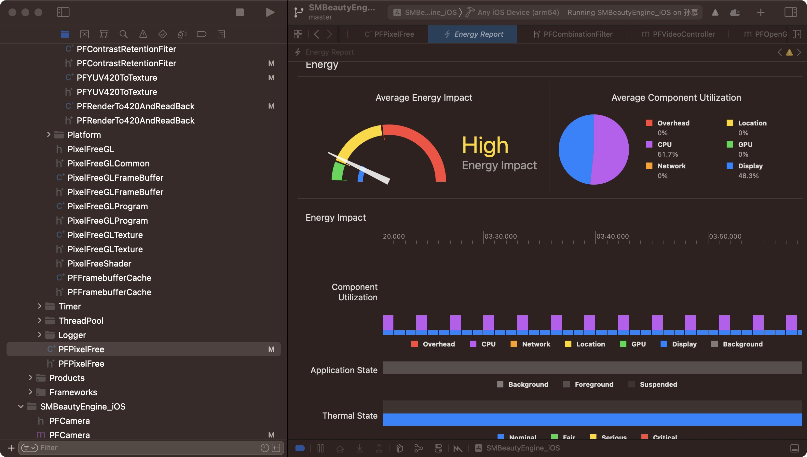
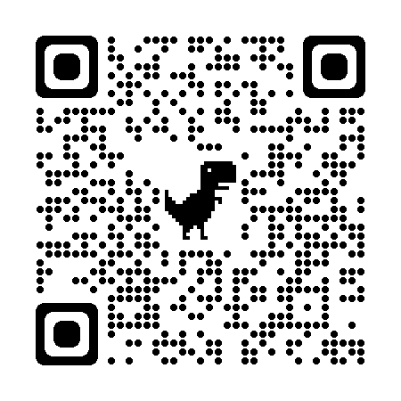

# PixelFree 美颜与图像特效 SDK

面向实时音视频与图片编辑的美颜、美型、美体、美妆、智能分割和专业调色 SDK。

[中文](./README.md) | [English](./README_en.md)

[功能概览](#features) · [平台与工程](#platforms) · [快速接入](#quick-start) · [进阶能力](#advanced) · [接入文档](#docs) · [体验 Demo](#demos)

## 项目介绍

**PixelFree** 为直播、视频通话、短视频、相机、证件照和人像修图提供图像处理能力。本仓库提供 SDK 交付包、平台 Demo、UI 接入参考和使用文档，开发者可以将处理后的像素或纹理接入自己的预览、编码、推流与图片导出流程。

- **实时视频处理**：按帧配置美颜、美型、美妆、滤镜和贴纸，支持 CPU 图像与 OpenGL 纹理接入。
- **图片精修**：支持独立检测、结果快照、逐人脸／逐人体参数配置，以及从原图反复渲染。
- **图像创作**：提供语义分割遮罩、外部 LUT、HSL、曲线、颗粒、分离色调与参考图仿色。
- **工程集成**：提供图像／视频检测模式、资源加载、能力查询、错误码和日志接口。

> 本页的移动端说明以仓库当前的 **iOS Framework 公开头文件与 Android AAR 导出接口**为准。具体功能取决于交付包、配套资源与授权；其他平台和跨平台插件需以各自版本为准。运行时版本可通过 iOS/C 的 `PF_Version()`、Android 的 `getVersion()` 查询。

<a id="features"></a>

## 功能概览

| 模块 | 主要能力 | 使用说明 |
| :--- | :--- | :--- |
| 基础美肤 | 磨皮、美白、红润、锐化、亮眼、美牙、祛法令纹、祛黑眼圈、AI 祛瑕疵 | 支持单项强度调节；可配置皮肤 Mask 与人脸区域磨皮 |
| 皮肤质感 | 纹理、清晰柔光、高光柔光、水光、哑光 | 通过 `PFBeautyFilterSkinDetail*` 参数调节 |
| 肤色调整 | 自然、白皙、粉白、小麦色、美黑 | 独立控制肤色强度与冷暖；需要 `skin_src.bundle` |
| 精细美型 | 大眼、瘦脸、窄脸、V 脸、小脸、下巴、额头、鼻部、人中、眼距、眼角、微笑嘴角 | 进一步支持眼睛位置与高度、鼻尖与鼻梁、眉形、上／下唇厚度、丰唇与唇宽 |
| 面部填充 | 额头、泪沟、眼窝、苹果肌、下巴、面颊、眉弓、鼻基底、嘴角 | 九项独立图像修饰参数；可查询当前资源支持情况 |
| 面部提升与修饰 | 额头、眼周、颧颊、口周、轮廓提升，牙齿修饰、轮廓平滑 | 牙齿修饰与美牙为独立参数；以能力查询结果为准 |
| 一键美颜 | 自然、可爱、女神、白净、甜美、质感、硬派 | 使用 `PFBeautyTypeOneKey` 预设 |
| 身体塑形 | 瘦身、瘦腰、瘦肚子、沙漏腰、曲线、全身瘦、提胯、丰臀、丰胸、长腿、天鹅颈、肩部与四肢调节 | 支持美体预设、人体选择及长腿控制线；需要人体资源与授权 |
| 美妆 | 眉毛、腮红、眼影、眼线、睫毛、唇彩、高光、阴影、粉底 | 支持资源包加载、分部位强度与面部遮挡控制 |
| 滤镜与 LUT | 内置风格滤镜、外部 LUT、独立强度控制 | 外部 LUT 使用 256 × 256、8 × 8 分块布局 |
| 专业调色 | 亮度、对比度、曝光、高光、阴影、黑白场、饱和度、自然饱和度、色温、色调、色相 | 另含氛围、清晰度、结构、锐化、降噪、光感、褪色、暗角、柔光与颗粒 |
| 局部色彩与曲线 | 八色 HSL、自定义关键色、阴影／高光分离色调、RGB 总曲线与分通道曲线 | 最多 16 组自定义 HSL；每条曲线最多 32 个控制点 |
| 参考图仿色 | 从参考图提取色彩风格并应用到源图 | 独立处理入口，支持强度调节；与常规美颜／调色链路分开调用 |
| 人脸与人体检测 | 多人脸框、ID、168 点人脸关键点、人体框和检测结果快照 | 支持图片场景逐人脸美颜／美妆／贴纸、逐人体塑形 |
| 智能分割 | 头发、头部、皮肤、人像语义遮罩 | 独立 CPU 图像输入，输出概率 Mask；天空类型暂未开放 |
| 贴纸与合成 | 2D 动态贴纸、自定义贴纸、水印、绿幕背景替换 | 绿幕抠像与人像语义分割为不同能力；素材数量取决于交付资源 |

### 参数约定

| 参数类别 | 范围与中性值 |
| :--- | :--- |
| 常规效果强度 | 通常为 `0.0～1.0`，`0` 关闭；具体以对应枚举说明为准 |
| 双向美型与美体单项 | 通常为 `0.0～1.0`，`0.5` 中性；不能统一用 `0` 重置所有参数 |
| 美体预设 | 使用 `PFBodyBeautyType` 中的预设项，取整数 `0～6` |
| 肤色冷暖 | `0` 偏冷、`0.5` 中性、`1` 偏暖 |
| 调色 | 有符号参数为 `-1～1`、中性 `0`；锐化、降噪、褪色、柔光、颗粒和分离色调强度等为 `0～1` |
| 曲线 | 坐标为 `0～1`；空曲线保持原样，否则须为 `2～32` 点且横坐标严格递增 |

请使用当前 SDK 的枚举和类型，避免跨版本硬编码数字。iOS 的通用美颜入口为 `pixelFreeSetBeautyFilterParam:value:`；Android 保留历史方法名 `pixelFreeSetBeautyFiterParam`，其中 `Fiter` 的拼写是接口名称的一部分。

<a id="platforms"></a>

## 平台与工程

| 平台 | 仓库入口 | 当前交付说明 |
| :--- | :--- | :--- |
| iOS | [iOS Demo 与 Framework](./SMBeautyEngine_iOS) | 当前 Framework 为 iPhoneOS `arm64`，包声明最低 iOS 12.0；Demo 工程部署目标为 iOS 15.0，当前包不包含模拟器切片 |
| Android | [Android Demo 与 AAR](./SMBeautyEngine_andriod/pixelfree_android_demo) | 当前 AAR 含 `arm64-v8a`、`armeabi-v7a`，清单声明最低 API 19；Demo 为 API 21 / Android 5.0 起，集成时还需满足应用依赖的要求 |
| Android CameraX | [纹理接入示例](./SMBeautyEngine_andriod/CameraX_Texture) | 演示相机纹理接入；使用新版接口前需同步其依赖的 AAR 与资源 |
| Flutter | [Flutter 插件与示例](./SMBeautyEngine_flutter/pixelfree) | 接口覆盖范围以插件版本为准 |
| uni-app | [uni-app 示例](./SMBeautyEngine_uniapp) | 接口覆盖范围以插件版本为准 |
| HarmonyOS | [HarmonyOS 工程](./SMBeautyEngine_harmonyOS) | 查看对应工程配置与 SDK |
| Windows / Python | [Windows](./SMBeautyEngine_windows) · [Python 示例](./SMBeautyEngine_win_python) | 查看对应交付包与运行要求 |
| macOS / Linux | [macOS](./SMBeautyEngine_mac) · [Linux](./SMBeautyEngine_linux) | 查看各平台说明与示例 |

上述最低版本是当前包或 Demo 的配置值，不代表所有高级功能在所有设备上均可用。接入时请同时确认 ABI、图形环境、模型资源与授权能力。

<a id="quick-start"></a>

## 快速接入

### 1. 准备 SDK、资源与授权

使用同一交付版本的二进制、头文件／AAR、模型和素材。iOS 可从本仓库手动集成 `PixelFree.framework`，Android 可参考 Demo 的 `sdk-aar` 模块集成本地 AAR。

| 文件／资源 | 用途 | 加载方式 |
| :--- | :--- | :--- |
| `pixelfreeAuth.lic` | 与应用、平台和已开通功能匹配的授权文件 | iOS 初始化参数；Android `auth(...)` |
| `filter_model.bundle` | 基础美颜与相关资源 | iOS `srcFilterPath`；Android `PFSrcTypeFilter` |
| `body_model.bundle` | 人体检测、美体及相关能力 | `PFSrcTypeHumanProcessor`，按需加载 |
| `skin_src.bundle` | 肤色调整资源 | `PFSrcTypeSkinSrc`，按需加载 |
| 美妆／贴纸／LUT | 对应效果素材 | 使用相应资源加载或路径接口 |

Android 当前 AAR 已包含上述三类模型／肤色 bundle，应用仍需按功能调用加载接口，并提供自己的授权文件。iOS 需确保资源已加入目标并能取得有效路径，资源位置可参考 Demo。

### 2. iOS：初始化、配置与处理

以下为 Objective-C++（`.mm`）调用片段。假设已提供有效的 BGRA 或双平面 NV12 `pixelBuffer`，图像方向为 0°。在同一串行处理队列上管理实例及其 GL 上下文，并持有实例供后续帧复用。

```objective-c++
#import <PixelFree/SMPixelFree.h>

NSString *modelPath = [[NSBundle mainBundle] pathForResource:@"filter_model"
                                                    ofType:@"bundle"];
NSString *licensePath = [[NSBundle mainBundle] pathForResource:@"pixelfreeAuth"
                                                      ofType:@"lic"];
NSCAssert(modelPath && licensePath, @"Missing PixelFree resources");

EAGLContext *context = [[EAGLContext alloc] initWithAPI:kEAGLRenderingAPIOpenGLES2];
[EAGLContext setCurrentContext:context];
SMPixelFree *beauty = [[SMPixelFree alloc] initWithProcessContext:context
                                               srcFilterPath:modelPath
                                                    authFile:licensePath];
[beauty setDetectMode:PF_FACE_DETECT_MODE_VIDEO];

float smoothing = 0.5f;
[beauty pixelFreeSetBeautyFilterParam:PFBeautyFilterTypeFaceBlurStrength
                              value:&smoothing];

// 可选：调色会随正常处理自动应用，无需额外渲染一次。
PFColorGradingParams grading;
PF_initColorGradingParams(&grading);
grading.contrast = 0.1f;
int gradingStatus = [beauty pixelFreeSetColorGrading:&grading];
if (gradingStatus != 0) NSLog(@"Color grading error: %d", gradingStatus);

// 每帧执行：处理会回写 pixelBuffer，需保留原图时请先复制。
int texture = [beauty processWithBuffer:pixelBuffer rotationMode:PFRotationMode0];
int error = [beauty getLastErrorCode];
if (texture < 0 || error != 0) NSLog(@"PixelFree result: %d, error: %d", texture, error);
```

已有 GL 纹理时可使用 `processWithTexture:width:height:rotation:`，在 `beauty.glContext` 中原位处理输入纹理；成功返回输入纹理 ID，失败返回负值。图片便捷入口为 `processWithImage:rotationMode:`。处理结束后，在所属处理队列与 GL 上下文中释放实例及应用自有资源。

### 3. Android：初始化、配置与处理

以下为 Kotlin 调用片段，假设 `context` 为 Android `Context`，`rgbaBytes` 是尺寸为 `width × height` 的紧凑 RGBA 字节数组。初始化和参数配置只需执行一次，逐帧复用实例；耗时帧处理应放在工作队列中。

```kotlin
import com.hapi.pixelfree.*

val beauty = PixelFree()
beauty.create()
check(beauty.isCreate())

val license = requireNotNull(beauty.readBundleFile(context, "pixelfreeAuth.lic"))
beauty.auth(context, license, license.size)
val model = requireNotNull(beauty.readBundleFile(context, "filter_model.bundle"))
beauty.createBeautyItemFormBundle(model, model.size, PFSrcType.PFSrcTypeFilter)
beauty.setDetectMode(PFFaceDetectMode.PF_FACE_DETECT_MODE_VIDEO)
beauty.pixelFreeSetBeautyFiterParam(
    PFBeautyFilterType.PFBeautyFilterTypeFaceBlurStrength, 0.5f
)
val gradingStatus = beauty.setColorGrading(PFColorGradingParams(contrast = 0.1f))
check(gradingStatus == 0) { "Color grading error: $gradingStatus" }

// 每帧执行；wigth 是当前公开字段的实际拼写。
val input = PFImageInput().also {
    it.wigth = width
    it.height = height
    it.p_data0 = rgbaBytes
    it.stride_0 = width * 4
    it.format = PFDetectFormat.PFFORMAT_IMAGE_RGBA
    it.rotationMode = PFRotationMode.PFRotationMode0
}
beauty.processWithBuffer(input)
val error = beauty.getLastErrorCode()
check(error == 0) { "PixelFree error: $error" }
// rgbaBytes 已回写；input.textureID 可在对应 GL 上下文中使用。

// 停止提交帧并结束整个处理会话后调用，而非每帧调用。
beauty.release()
```

如应用已有渲染线程，可使用 `setRenderThreadDispatcher(...)` 绑定调度，或在有效的当前 GL 上下文中调用 `createOnCurrentGLThread()`、`processWithBufferOnCurrentGLThread(...)` 等配套接口。需要 GPU 后续处理时，可选用 `processWithBufferToTexture(...)` 或其 `OnCurrentGLThread` 版本；此路径不回写 CPU 像素，输出纹理应在同一上下文中、下一次处理或 GL 资源释放前消费。

`PFDetectFormat` 定义了多种格式，但每个入口支持范围不同。实际接入时应检查平面布局、行步长、旋转和纹理所属上下文，不要仅根据枚举存在就认定任意接口支持该格式。

<a id="advanced"></a>

## 进阶能力与接口索引

### 图片精修与逐人编辑

图片编辑建议先调用独立检测接口取得快照，再按快照中的 `faceId`／`bodyId` 构建配置。每次滑杆调整都从未处理的原图生成输出，可复用同一来源的检测结果，避免反复叠加变形。

| 能力 | iOS | Android |
| :--- | :--- | :--- |
| 独立人脸检测 | `detectFacesWithBuffer:rotationMode:` | `detectFacesWithBuffer(...)` |
| 逐人脸美颜／美妆 | `processWithBuffer:rotationMode:faceDetection:faceConfigs:count:` | `processWithBufferAndFaces(...)` |
| 逐人脸贴纸 | 上述重载追加 `stickerConfigs:stickerCount:` | `processWithBufferAndFaceEffects(...)` |
| 独立人体检测 | `detectBodiesWithBuffer:rotationMode:` | `detectBodiesWithBuffer(...)` |
| 逐人体塑形 | `processWithBuffer:rotationMode:bodyDetection:bodyConfigs:bodyCount:` | `processWithBufferAndBodies(...)` |
| 人脸、贴纸、人体联合处理 | 同时接收人脸和人体快照的 `processWithBuffer:...` 重载 | `processWithBufferAndEffects(...)` |
| 最近一帧的框与关键点 | `pixelFreeGetFaceRects:maxCount:`、`pixelFreeGetFaceLandmarks168:maxFaces:`、`pixelFreeGetHumanRects:maxCount:` | `getFaceRects(...)`、`getFaceLandmarks168(...)`、`getHumanRects(...)` |
| 人体选择与长腿控制 | `pixelFreeSetBodyBeautyTargetIndex:`、`pixelFreeSetBodyLongLegControl:` | `setBodyBeautyTargetIndex(...)`、`setBodyLongLegControl(...)` |

人脸快照及 168 点读取需要高级美颜／美型授权（BeautyV2）；人体快照需要人体授权和 `body_model.bundle`。快照 ID 只标识该次检测中的对象，不是跨照片的身份标识。168 点是公开输出布局，包含估计点；人体快照公开人体框及元数据，不提供人体关键点数组。

快照必须与创建它的引擎、源图和旋转匹配；更换源图、裁剪或变形后应重新检测。Android 的人脸／人体快照实现 `Closeable`，使用 `use { ... }` 或显式 `close()` 释放；iOS 应在渲染完成前持有快照，借用的数据指针不可超出快照生命周期。

联合处理接口中，未提供快照的类别会关闭，不自动继承全局美颜、美妆或贴纸配置。普通 IMAGE 模式在换图或方向变化时调用 `resetDetectState()`；使用人体选择接口时，重置后需重新处理和选择目标。

### 智能分割

`getSegmentationAvailability` 返回当前可用的类型位；调用 `segmentWithBuffer` 时按位组合需要的类型。

| 类型 | 输出用途 | 前提 |
| :--- | :--- | :--- |
| Hair / 头发 | 染发或局部处理所需遮罩 | 对应模型资源与 BeautyV2 授权 |
| Head / 头部 | 头部区域选择 | 对应模型资源与 BeautyV2 授权 |
| Skin / 皮肤 | 皮肤局部处理 | 对应模型资源与 BeautyV2 授权 |
| Human / 人像 | 背景合成等应用所需前景遮罩 | 人体资源与授权 |
| Sky / 天空 | 保留类型 | 当前不可用 |

独立分割是同步 CPU 检测，不修改输入像素、不执行美颜渲染。输出为整帧语义概率 Mask，值域 `0～1`，不包含逐人 ID；实际尺寸以结果为准，`stride` 单位为浮点元素数。背景替换、羽化和染色等合成由应用使用 Mask 完成。

- **iOS 输入**：BGRA 或全范围双平面 NV12（BT.601）；独立分割不接受视频范围 NV12。
- **Android 输入**：RGB/BGR、RGBA/BGRA/ARGB/ABGR、GRAY、双平面 NV12/NV21 字节数组；当前包装接口不支持 I420 或纯纹理输入。YUV 应为全范围 BT.601。
- **坐标**：独立分割 Mask 和最近一帧的检测框使用原始输入坐标；人脸／人体检测快照使用方向校正后的坐标，均以左上为原点。显示叠加时应区分坐标空间。
- **结果持有**：iOS 的 Mask 指针随 `SMPixelFreeSegmentation` 对象存活；Android 的 `PFSegmentationResult` 持有数据副本，无需 `close()`。旧的 `pixelFreeGetHumanSegmentationResult:` 返回的是帧缓存，不能按独立快照的生命周期使用。
- **失败处理**：iOS 返回 `nil` 与 `NSError`；Android 抛出携带错误码的 `PFSegmentationException`。不要把不可用或未授权当成空前景。

### 调色、滤镜与参考图仿色

| 能力 | iOS | Android |
| :--- | :--- | :--- |
| 设置／重置专业调色 | `pixelFreeSetColorGrading:` / `pixelFreeResetColorGrading` | `setColorGrading(...)` / `resetColorGrading()` |
| 外部 LUT | `pixelFreeSetExternalFilterWithPath:intensity:enabled:` | `setExternalFilter(...)` |
| 肤色调整 | `pixelFreeSetSkinToneFilter:` | `setSkinToneFilter(...)` |
| 参考图仿色 | `processColorTransferWithSource:reference:params:output:` | `processColorTransfer(...)` |
| 面部填充／提升能力查询 | `pixelFreeGetRejuvenationAvailability` | `getRejuvenationAvailability()` |
| 最近一次错误 | `getLastErrorCode` | `getLastErrorCode()` |

调色参数通过 `PFColorGradingParams` 配置，会在正常美颜、美体和贴纸处理后、最终输出前自动应用。iOS/C 应先调用 `PF_initColorGradingParams`，Android 可使用默认构造参数。只调整调色参数时，无需手动再跑一次完整美颜流程。

参考图仿色使用独立入口：源图是被调整的图片，参考图提供色彩风格。iOS/C 需启用 `PFColorTransferFeatureColor`，Android 需启用 `PFColorTransferFeature.COLOR`；默认未启用时仅复制原图。强度分别使用 `strength` 和 `degree`（`0～1`），输出缓冲区由调用方提供。当前接口需要美体授权；它不会同时执行美颜、美体、美妆、贴纸或常规调色。

### 集成注意事项

1. **线程与上下文**：将同一引擎的参数设置、资源更新、渲染和销毁串行化。纹理只可在所属或正确共享的 GL 上下文中使用，跨线程传递纹理 ID 本身不构成同步。
2. **原图与缓存**：常规 buffer 路径会回写像素，图片编辑应保留原图；IMAGE 模式换图或改变方向后重置检测状态，快照编辑则重新检测。
3. **资源与授权**：先加载对应资源，再配置功能。通过能力查询与返回值判断可用性；`isCreate()` 仅说明实例创建状态，不表示所有功能已获授权。
4. **错误诊断**：检查各接口自己的返回值／异常，以及 `getLastErrorCode`。公共错误包含参数错误、模型或 GL 初始化失败、授权不匹配／过期、功能未授权及未检测到人脸／人体；独立分割、快照、调色与仿色还有各自的错误码。
5. **性能评估**：在目标设备上分别测量首帧、稳定帧率、分辨率、检测人数、启用功能和 CPU／GPU 数据传输开销。纹理链路可减少不必要的读回，但不能以历史示例数据承诺所有设备的性能。

## 效果展示

[一键美颜](https://youtube.com/shorts/DrH07vYCjxo?feature=share) · [美肤](https://youtube.com/shorts/HyrIGTSJ2zw) · [美型](https://youtube.com/shorts/LIqiX36eK5o) · [滤镜](https://youtube.com/shorts/31kJmS0pXQo) · [贴纸](https://youtube.com/shorts/7lc1k9PGsNA) · [调色](https://youtube.com/shorts/JkV4KY5Qkbo)


<details>
<summary>历史性能测试图（仅供参考）</summary>



实际表现受设备、分辨率、功能组合和 SDK 版本影响，请以目标场景实测为准。

</details>

<a id="docs"></a>

## 接入文档与生态

| 文档 | 入口 |
| :--- | :--- |
| iOS | [接入指南](./doc/doc_iOS.md) · [API 说明](./doc/api_iOS.md) · [当前 Objective-C 头文件](./SMBeautyEngine_iOS/PixelFree.framework/Headers/SMPixelFree.h) |
| Android | [接入指南](./doc/doc_android.md) · [API 说明](./doc/api_android.md) · [当前 AAR](./SMBeautyEngine_andriod/pixelfree_android_demo/sdk-aar/lib_pixelFree.aar) |
| C / 调色类型 | [C API](./doc/api_c.md) · [当前 C 头文件](./SMBeautyEngine_iOS/PixelFree.framework/Headers/pixelFree_c.hpp) · [调色参数](./SMBeautyEngine_iOS/PixelFree.framework/Headers/PFColorGradingParams.h) |
| 其他平台 | [Flutter](./doc/doc_flutter.md) · [Windows](./doc/doc_windows.md) · [macOS](./SMBeautyEngine_mac/readme_mac.md) · [Linux](./SMBeautyEngine_linux/README.md) |
| 素材与维护 | [自定义贴纸](./doc/custom_stickers.md) · [常见问题](./doc/frequently_asked_questions.md) · [更新日志](./doc/release_note.md) |

部分接入文档保留旧版本示例；与本页或当前交付包不一致时，以实际头文件和 AAR 签名为准。升级时请同时更新二进制、枚举、资源和调用代码。

已有七牛云、声网（Agora）、腾讯、即构（ZEGO）等音视频场景的接入参考。常见接入位置为「采集 → PixelFree 处理 → 预览／编码／推流」，具体帧格式、纹理类型与线程约束由所用音视频 SDK 决定。

<a id="demos"></a>

## 体验 Demo

| Android | iOS |
| :---: | :---: |
| [下载 Android Demo](https://www.pgyer.com/Cy9pG8) | [加入 TestFlight](https://testflight.apple.com/join/KWUMyqrh) |
|  |  |

体验包版本与源码仓库可能不同，功能和素材以实际安装版本为准。

## 授权与联系

仓库许可证见 [LICENSE](./LICENSE)。SDK 功能运行需要有效授权，试用、商业接入和模块开通请联系：微信 `17376595626`，邮箱 [pixelfree@163.com](mailto:pixelfree@163.com)。

演示素材仅用于效果展示；如涉及权利问题，请通过上述联系方式告知以便处理。
