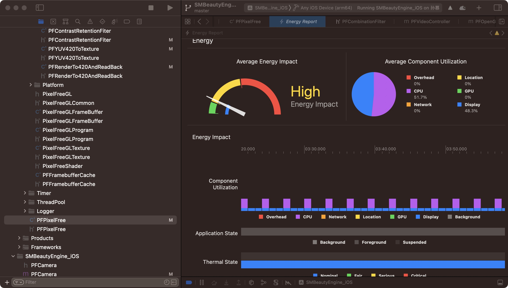

# PixelFree Beauty & Image Effects SDK

Beauty, face and body shaping, makeup, intelligent segmentation, and professional color grading for real-time video and photo editing.

[English](./README_en.md) | [中文](./README.md)

[Features](#features) · [Platforms](#platforms) · [Quick Start](#quick-start) · [Advanced APIs](#advanced) · [Documentation](#docs) · [Demo Apps](#demos)

## Overview

**PixelFree** provides image processing for live streaming, video calls, short videos, cameras, ID photos, and portrait editors. This repository contains SDK packages, platform demos, UI integration references, and documentation. Processed pixels or textures can feed your application's preview, encoder, streaming pipeline, or image export.

- **Real-time video**: configure beauty, face shaping, makeup, filters, and stickers per frame, with CPU image and OpenGL texture inputs.
- **Photo editing**: separate detection from rendering, retain detection snapshots, and configure effects per face or body while rendering from the original image.
- **Creative tools**: semantic masks, external LUTs, HSL, curves, grain, split toning, and reference-image color transfer.
- **Integration controls**: image/video detection modes, resource loading, capability queries, error reporting, and logging.

> Mobile API descriptions on this page match the **public headers in the current iOS Framework and exported interfaces in the Android AAR** in this repository. Availability depends on the package, resources, and license. Other platforms and cross-platform plugins have their own API coverage. Query the runtime version with `PF_Version()` on iOS/C or `getVersion()` on Android.

<a id="features"></a>

## Features

| Module | Capabilities | Integration notes |
| :--- | :--- | :--- |
| Skin enhancement | Smoothing, whitening, rosy tone, sharpening, eye brightening, teeth whitening, nasolabial fold and dark circle reduction, AI blemish removal | Individual controls, configurable skin masks and face-region smoothing |
| Skin detail | Texture, clarity soft light, highlight soft light, water glow, matte finish | Controlled through `PFBeautyFilterSkinDetail*` parameters |
| Skin tone | Natural, fair, pink-white, wheat, tan | Separate intensity and temperature controls; requires `skin_src.bundle` |
| Face shaping | Eyes, face width, V shape, small face, chin, forehead, nose, philtrum, eye spacing, eye corners, smile | Additional controls for eye position/height, nose tip/bridge, brows, upper/lower lips, lip fullness and width |
| Facial filling | Forehead, tear troughs, eye sockets, apple cheeks, chin, cheeks, brow arches, nasal base, mouth corners | Nine independent visual retouching controls; query resource availability |
| Facial lifting and retouching | Forehead, periorbital, malar, perioral and contour lifting, teeth retouching, contour smoothing | Teeth retouching is separate from whitening; check capability flags |
| Beauty presets | Natural, Cute, Goddess, Fair, Sweet, Texture, Hard | Available through `PFBeautyTypeOneKey` |
| Body shaping | Overall slimming, waist, belly, hourglass, curves, body width, hips, bust, legs, neck, shoulders, arms and legs | Body presets, target selection, and long-leg control lines; requires body resources and authorization |
| Makeup | Brows, blush, eyeshadow, eyeliner, eyelashes, lips, highlights, shadows, foundation | Resource packages, per-part intensity, and face occlusion control |
| Filters and LUTs | Built-in looks, external LUTs, adjustable strength | External LUTs use a 256 × 256 image with an 8 × 8 tile layout |
| Color grading | Brightness, contrast, exposure, highlights, shadows, blacks, whites, saturation, vibrance, temperature, tint, hue | Also ambiance, clarity, structure, sharpening, denoise, light sensation, fade, vignette, glow, and grain |
| Selective color and curves | Eight HSL bands, custom key colors, shadow/highlight split toning, master RGB and per-channel curves | Up to 16 custom HSL bands and 32 control points per curve |
| Reference color transfer | Apply a reference image's color style to a source image | Separate processing API with adjustable strength |
| Face and body detection | Multiple face bounds and IDs, 168 facial landmarks, body bounds, owned detection snapshots | Per-face beauty/makeup/stickers and per-body shaping for photo editing |
| Intelligent segmentation | Hair, head, skin, and human semantic masks | Separate CPU image input with probability masks; sky is reserved and unavailable |
| Stickers and compositing | Animated 2D stickers, custom stickers, watermarks, green-screen background replacement | Chroma key and human segmentation are separate capabilities; asset counts depend on the delivered resources |

### Parameter conventions

| Parameter category | Range and neutral value |
| :--- | :--- |
| Standard effect intensity | Usually `0.0–1.0`, with `0` disabled; consult the specific parameter definition |
| Bidirectional face/body controls | Usually `0.0–1.0`, with `0.5` neutral; setting every parameter to zero is not a valid universal reset |
| Body preset | Integer `0–6` through the preset entry in `PFBodyBeautyType` |
| Skin-tone temperature | `0` cool, `0.5` neutral, `1` warm |
| Grading | Signed controls use `-1–1`, neutral `0`; sharpen, denoise, fade, glow, grain controls and split-tone intensities use `0–1` |
| Curves | Coordinates in `0–1`; empty means identity, otherwise `2–32` points with strictly increasing x coordinates |

Use the enums and types shipped with your SDK instead of hardcoding numeric values across versions. The iOS beauty setter is `pixelFreeSetBeautyFilterParam:value:`. Android retains the historical spelling `pixelFreeSetBeautyFiterParam`; `Fiter` is part of the actual API name.

<a id="platforms"></a>

## Platforms and Projects

| Platform | Repository entry | Current package notes |
| :--- | :--- | :--- |
| iOS | [Demo and Framework](./SMBeautyEngine_iOS) | Current Framework targets iPhoneOS `arm64` and declares iOS 12.0 minimum; the demo targets iOS 15.0. No simulator slice is included |
| Android | [Demo and AAR](./SMBeautyEngine_andriod/pixelfree_android_demo) | AAR contains `arm64-v8a` and `armeabi-v7a`, with manifest minimum API 19; demo minimum is API 21 / Android 5.0. Application dependencies may impose higher requirements |
| Android CameraX | [Texture integration example](./SMBeautyEngine_andriod/CameraX_Texture) | Camera texture reference; update its AAR and resources before using newer interfaces |
| Flutter | [Plugin and example](./SMBeautyEngine_flutter/pixelfree) | API coverage depends on plugin version |
| uni-app | [Example](./SMBeautyEngine_uniapp) | API coverage depends on plugin version |
| HarmonyOS | [Project](./SMBeautyEngine_harmonyOS) | See its project configuration and SDK |
| Windows / Python | [Windows](./SMBeautyEngine_windows) · [Python example](./SMBeautyEngine_win_python) | See platform packages and runtime requirements |
| macOS / Linux | [macOS](./SMBeautyEngine_mac) · [Linux](./SMBeautyEngine_linux) | See platform documentation and examples |

These minimum versions describe the current package or demo configuration. They do not guarantee every advanced feature on every device. Check ABI, graphics support, model resources, and authorization for your deployment.

<a id="quick-start"></a>

## Quick Start

### 1. Prepare the SDK, resources, and license

Use binaries, headers/AAR, models, and assets from the same delivery. Integrate the supplied `PixelFree.framework` manually on iOS, or follow the Android demo's `sdk-aar` module for local AAR integration.

| File or resource | Purpose | Loading API |
| :--- | :--- | :--- |
| `pixelfreeAuth.lic` | License matching your application, platform, and enabled features | iOS initializer; Android `auth(...)` |
| `filter_model.bundle` | Base beauty and related resources | iOS `srcFilterPath`; Android `PFSrcTypeFilter` |
| `body_model.bundle` | Body detection, shaping, and related capabilities | `PFSrcTypeHumanProcessor`, loaded as needed |
| `skin_src.bundle` | Skin-tone resources | `PFSrcTypeSkinSrc`, loaded as needed |
| Makeup / stickers / LUTs | Effect-specific assets | Corresponding resource or path APIs |

The current Android AAR includes the three model/skin resource bundles above. Load them through the appropriate API and supply your own license. On iOS, add resources to the application target and resolve valid paths as shown in the demo.

### 2. iOS: initialize, configure, and process

The following Objective-C++ (`.mm`) fragment assumes a valid BGRA or bi-planar NV12 `pixelBuffer` with 0° rotation. Manage the instance and GL context on one serial processing queue, and retain the instance for subsequent frames.

```objective-c++
#import <PixelFree/SMPixelFree.h>

NSString *modelPath = [[NSBundle mainBundle] pathForResource:@"filter_model"
                                                    ofType:@"bundle"];
NSString *licensePath = [[NSBundle mainBundle] pathForResource:@"pixelfreeAuth"
                                                      ofType:@"lic"];
NSCAssert(modelPath && licensePath, @"Missing PixelFree resources");

EAGLContext *context = [[EAGLContext alloc] initWithAPI:kEAGLRenderingAPIOpenGLES2];
[EAGLContext setCurrentContext:context];
SMPixelFree *beauty = [[SMPixelFree alloc] initWithProcessContext:context
                                               srcFilterPath:modelPath
                                                    authFile:licensePath];
[beauty setDetectMode:PF_FACE_DETECT_MODE_VIDEO];

float smoothing = 0.5f;
[beauty pixelFreeSetBeautyFilterParam:PFBeautyFilterTypeFaceBlurStrength
                              value:&smoothing];

// Optional: regular processing applies grading automatically.
PFColorGradingParams grading;
PF_initColorGradingParams(&grading);
grading.contrast = 0.1f;
int gradingStatus = [beauty pixelFreeSetColorGrading:&grading];
if (gradingStatus != 0) NSLog(@"Color grading error: %d", gradingStatus);

// Per frame: processing writes back to pixelBuffer. Copy first to preserve it.
int texture = [beauty processWithBuffer:pixelBuffer rotationMode:PFRotationMode0];
int error = [beauty getLastErrorCode];
if (texture < 0 || error != 0) NSLog(@"PixelFree result: %d, error: %d", texture, error);
```

For an existing GL texture, use `processWithTexture:width:height:rotation:` in `beauty.glContext`. It processes the supplied texture in place, returning its ID on success or a negative error. `processWithImage:rotationMode:` provides a convenience image entry point. After processing ends, release the instance and application-owned resources on the owning processing queue and GL context.

### 3. Android: initialize, configure, and process

This Kotlin fragment assumes an Android `Context` named `context` and a tightly packed RGBA `rgbaBytes` array for a `width × height` image. Initialize and configure once, reuse the engine, and perform frame processing on a worker queue.

```kotlin
import com.hapi.pixelfree.*

val beauty = PixelFree()
beauty.create()
check(beauty.isCreate())

val license = requireNotNull(beauty.readBundleFile(context, "pixelfreeAuth.lic"))
beauty.auth(context, license, license.size)
val model = requireNotNull(beauty.readBundleFile(context, "filter_model.bundle"))
beauty.createBeautyItemFormBundle(model, model.size, PFSrcType.PFSrcTypeFilter)
beauty.setDetectMode(PFFaceDetectMode.PF_FACE_DETECT_MODE_VIDEO)
beauty.pixelFreeSetBeautyFiterParam(
    PFBeautyFilterType.PFBeautyFilterTypeFaceBlurStrength, 0.5f
)
val gradingStatus = beauty.setColorGrading(PFColorGradingParams(contrast = 0.1f))
check(gradingStatus == 0) { "Color grading error: $gradingStatus" }

// Per frame. wigth is the actual spelling of the public field.
val input = PFImageInput().also {
    it.wigth = width
    it.height = height
    it.p_data0 = rgbaBytes
    it.stride_0 = width * 4
    it.format = PFDetectFormat.PFFORMAT_IMAGE_RGBA
    it.rotationMode = PFRotationMode.PFRotationMode0
}
beauty.processWithBuffer(input)
val error = beauty.getLastErrorCode()
check(error == 0) { "PixelFree error: $error" }
// rgbaBytes contains the output; use input.textureID only in its GL context.

// Stop submitting frames, then release at the end of the session, not per frame.
beauty.release()
```

If your app owns a renderer, bind its dispatcher with `setRenderThreadDispatcher(...)`, or use `createOnCurrentGLThread()` and `processWithBufferOnCurrentGLThread(...)` on a valid current GL context. For GPU chaining, use `processWithBufferToTexture(...)` or its `OnCurrentGLThread` variant. This path does not write back CPU pixels; consume the output texture in the same context before the next processing call or GL resource release.

`PFDetectFormat` defines several formats, but accepted inputs vary by entry point. Verify plane layout, stride, rotation, and texture context. An enum value's existence does not mean every method accepts it.

<a id="advanced"></a>

## Advanced APIs and Usage

### Photo editing and per-person effects

For photo editors, detect first and retain a snapshot, then build configurations keyed by its `faceId` or `bodyId`. Render each slider adjustment from the unmodified source image. Reuse detection results only for a compatible source to avoid accumulating geometric changes.

| Capability | iOS | Android |
| :--- | :--- | :--- |
| Independent face detection | `detectFacesWithBuffer:rotationMode:` | `detectFacesWithBuffer(...)` |
| Per-face beauty / makeup | `processWithBuffer:rotationMode:faceDetection:faceConfigs:count:` | `processWithBufferAndFaces(...)` |
| Per-face stickers | Above overload with `stickerConfigs:stickerCount:` | `processWithBufferAndFaceEffects(...)` |
| Independent body detection | `detectBodiesWithBuffer:rotationMode:` | `detectBodiesWithBuffer(...)` |
| Per-body shaping | `processWithBuffer:rotationMode:bodyDetection:bodyConfigs:bodyCount:` | `processWithBufferAndBodies(...)` |
| Combined face, sticker, and body effects | `processWithBuffer:...` overload accepting both face and body snapshots | `processWithBufferAndEffects(...)` |
| Latest-frame bounds and landmarks | `pixelFreeGetFaceRects:maxCount:`, `pixelFreeGetFaceLandmarks168:maxFaces:`, `pixelFreeGetHumanRects:maxCount:` | `getFaceRects(...)`, `getFaceLandmarks168(...)`, `getHumanRects(...)` |
| Body selection / long-leg controls | `pixelFreeSetBodyBeautyTargetIndex:`, `pixelFreeSetBodyLongLegControl:` | `setBodyBeautyTargetIndex(...)`, `setBodyLongLegControl(...)` |

Face snapshots and 168-point access require advanced beauty/face-shaping authorization (BeautyV2). Body snapshots require body authorization and `body_model.bundle`. Snapshot IDs identify objects within that detection result, not identities across photos. The public 168-point layout includes estimated points. Body snapshots expose bounds and metadata, not a body-keypoint array.

Snapshots must match their creating engine, source image, and rotation. Detect again after changing, cropping, or warping the source. Android face/body snapshots implement `Closeable`; use `use { ... }` or `close()`. On iOS, retain snapshots until rendering completes and do not retain borrowed pointers beyond their owning snapshot's lifetime.

In the combined effects API, a category without a snapshot is disabled rather than inheriting global beauty, makeup, or sticker settings. For ordinary IMAGE mode, call `resetDetectState()` when the source or rotation changes. The body-target selection workflow requires processing and selecting a target again after reset.

### Intelligent segmentation

`getSegmentationAvailability` reports available type bits. Combine requested types with bitwise OR when calling `segmentWithBuffer`.

| Type | Output use | Requirements |
| :--- | :--- | :--- |
| Hair | Masks for recoloring or local adjustments | Corresponding models and BeautyV2 authorization |
| Head | Head-region selection | Corresponding models and BeautyV2 authorization |
| Skin | Local skin adjustments | Corresponding models and BeautyV2 authorization |
| Human | Foreground masks for background compositing | Body resources and authorization |
| Sky | Reserved | Currently unavailable |

Standalone segmentation performs synchronous CPU inference without modifying input pixels or rendering beauty effects. Results are whole-frame semantic probability masks in `0–1`, without per-person IDs. Read dimensions from the result; `stride` is measured in float elements. Your application uses the masks to implement background compositing, feathering, or recoloring.

- **iOS input**: BGRA or full-range bi-planar NV12 (BT.601). Standalone segmentation rejects video-range NV12.
- **Android input**: RGB/BGR, RGBA/BGRA/ARGB/ABGR, GRAY, or two-plane NV12/NV21 byte arrays. The current wrapper does not accept I420 or texture-only inputs. YUV must use full-range BT.601.
- **Coordinates**: standalone masks and latest-frame detection bounds use raw input coordinates. Face/body detection snapshots use orientation-corrected coordinates. All use a top-left origin; account for the distinction when drawing overlays.
- **Ownership**: iOS mask pointers remain valid for the lifetime of `SMPixelFreeSegmentation`. Android `PFSegmentationResult` owns data copies and needs no `close()`. The older iOS `pixelFreeGetHumanSegmentationResult:` exposes a frame cache with a shorter lifetime.
- **Errors**: iOS returns `nil` and an `NSError`; Android throws `PFSegmentationException` with an error code. Unavailable or unauthorized results must not be treated as empty foreground masks.

### Grading, filters, and reference color transfer

| Capability | iOS | Android |
| :--- | :--- | :--- |
| Set / reset grading | `pixelFreeSetColorGrading:` / `pixelFreeResetColorGrading` | `setColorGrading(...)` / `resetColorGrading()` |
| External LUT | `pixelFreeSetExternalFilterWithPath:intensity:enabled:` | `setExternalFilter(...)` |
| Skin tone | `pixelFreeSetSkinToneFilter:` | `setSkinToneFilter(...)` |
| Reference color transfer | `processColorTransferWithSource:reference:params:output:` | `processColorTransfer(...)` |
| Facial filling / lifting availability | `pixelFreeGetRejuvenationAvailability` | `getRejuvenationAvailability()` |
| Latest error | `getLastErrorCode` | `getLastErrorCode()` |

Configure grading with `PFColorGradingParams`. Normal processing applies it after beauty, body effects, and stickers, before final output. Initialize the structure with `PF_initColorGradingParams` on iOS/C, or use default constructor values on Android. A grading change does not require a second manually chained beauty pass.

Reference color transfer is separate: the source is recolored and the reference supplies the palette. Enable `PFColorTransferFeatureColor` on iOS/C or `PFColorTransferFeature.COLOR` on Android; the default disabled configuration only copies the source. Adjust `strength` on iOS/C or `degree` on Android in `0–1`, and provide the output buffer. The current API requires body authorization and does not also run beauty, body shaping, makeup, stickers, or regular grading.

### Integration considerations

1. **Threads and contexts**: serialize parameter changes, resource updates, rendering, and destruction for each engine. Textures require their owning or correctly shared GL context; passing an ID between threads does not provide synchronization.
2. **Source pixels and caches**: ordinary buffer processing overwrites pixels. Preserve originals for photo editing; reset ordinary IMAGE detection when the source/rotation changes, or create new snapshots for explicit editing sessions.
3. **Resources and authorization**: load the relevant resources before enabling a feature. Check capability queries and return values. `isCreate()` reports instance creation, not authorization for every feature.
4. **Diagnostics**: check each API's return value or exception, plus `getLastErrorCode`. Errors cover invalid arguments, model/GL initialization, application/platform mismatch, expired or missing feature authorization, and missing face/body detections. Segmentation, snapshots, grading, and color transfer also have dedicated error codes.
5. **Performance**: measure first-frame latency, steady-state throughput, resolution, detected person count, enabled features, and CPU/GPU transfers on target devices. Texture workflows can reduce unnecessary readback; historical figures are not a performance guarantee.

## Effect Previews

[Beauty presets](https://youtube.com/shorts/DrH07vYCjxo?feature=share) · [Skin enhancement](https://youtube.com/shorts/HyrIGTSJ2zw) · [Face shaping](https://youtube.com/shorts/LIqiX36eK5o) · [Filters](https://youtube.com/shorts/31kJmS0pXQo) · [Stickers](https://youtube.com/shorts/7lc1k9PGsNA) · [Color grading](https://youtube.com/shorts/JkV4KY5Qkbo)


<details>
<summary>Historical performance chart (reference only)</summary>



Results vary by device, resolution, feature combination, and SDK version. Benchmark your own workload.

</details>

<a id="docs"></a>

## Documentation and Integrations

| Documentation | Links |
| :--- | :--- |
| iOS | [Integration](./doc/doc_iOS.md) · [API reference](./doc/api_iOS.md) · [Current Objective-C header](./SMBeautyEngine_iOS/PixelFree.framework/Headers/SMPixelFree.h) |
| Android | [Integration](./doc/doc_android.md) · [API reference](./doc/api_android.md) · [Current AAR](./SMBeautyEngine_andriod/pixelfree_android_demo/sdk-aar/lib_pixelFree.aar) |
| C / grading types | [C API](./doc/api_c.md) · [Current C header](./SMBeautyEngine_iOS/PixelFree.framework/Headers/pixelFree_c.hpp) · [Grading parameters](./SMBeautyEngine_iOS/PixelFree.framework/Headers/PFColorGradingParams.h) |
| Other platforms | [Flutter](./doc/doc_flutter.md) · [Windows](./doc/doc_windows.md) · [macOS](./SMBeautyEngine_mac/readme_mac.md) · [Linux](./SMBeautyEngine_linux/README.md) |
| Assets and maintenance | [Custom stickers](./doc/custom_stickers.md) · [FAQ](./doc/frequently_asked_questions.md) · [Release notes](./doc/release_note.md) |

Some integration guides retain older examples. When they differ from this page or your package, follow the actual headers and AAR signatures. Upgrade binaries, enums, resources, and application calls together.

Integration references include Qiniu, Agora, Tencent, and ZEGO audio/video scenarios. A typical pipeline is **capture → PixelFree processing → preview / encoding / streaming**. Frame formats, texture types, and thread requirements depend on the audio/video SDK in use.

<a id="demos"></a>

## Demo Apps

| Android | iOS |
| :---: | :---: |
| [Download Android Demo](https://www.pgyer.com/Cy9pG8) | [Join TestFlight](https://testflight.apple.com/join/KWUMyqrh) |
|  |  |

Demo app releases may differ from this repository. Available features and assets depend on the installed version.

## Licensing and Contact

See [LICENSE](./LICENSE) for the repository license. SDK features require valid authorization. For evaluation, commercial integration, or module access, contact WeChat `17376595626` or [pixelfree@163.com](mailto:pixelfree@163.com).

Demo assets are used for effect previews. Please contact us about any rights concerns so they can be addressed.
